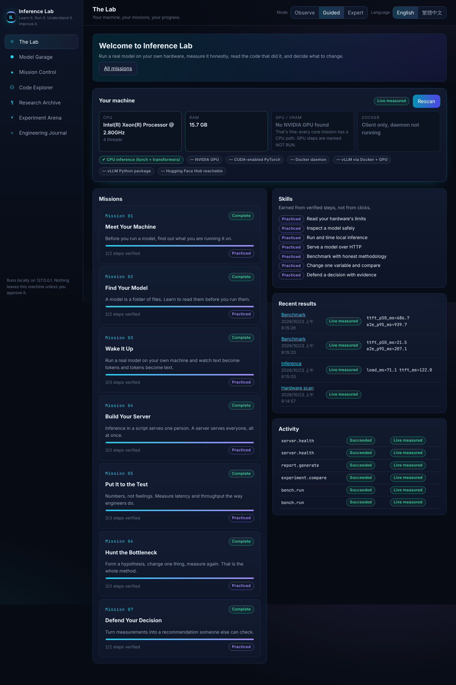
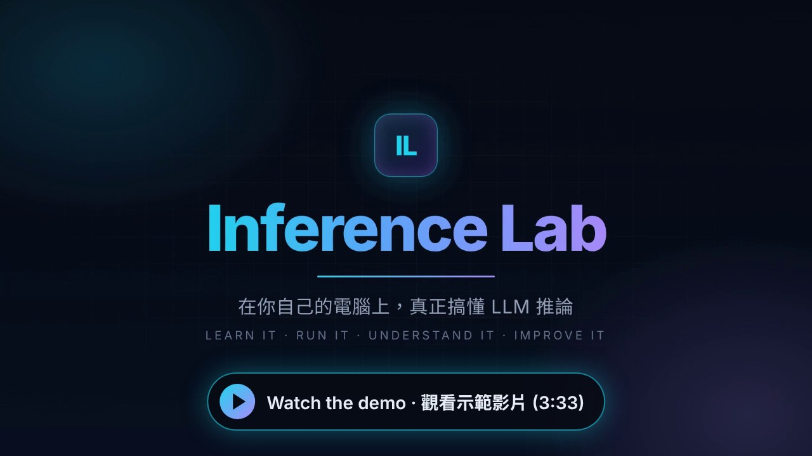

# Inference Lab

**Learn it. Run it. Understand it. Improve it.**

[繁體中文說明](README.zh-TW.md)

Inference Lab is a local, interactive workbench for learning AI inference engineering. You run a real model on
your own machine, benchmark it with honest methodology, read the exact code that did it, compare one change at a
time, and defend a decision with evidence. Every number is labelled with where it came from; nothing is simulated.



## Demo video

[](https://github.com/joojoohappy/Inference_Lab/blob/main/docs/media/inference-lab-demo-720p.mp4)

A 3½-minute tour with bilingual captions: hardware scan, all seven missions run for real, Experiment Arena,
Model Garage, Code Explorer, Research Archive and the Engineering Journal, plus measured llama.cpp results from a
Snapdragon X Plus laptop (CPU 33.0 tok/s vs Adreno GPU 17.8 tok/s; vLLM shown as NOT RUN, no GPU).
The UI walkthrough was recorded in a CPU-only cloud sandbox, with waits for compute cut or sped up.

## Quick start (CPU, works offline)

Requirements: Python 3.10+ (tested 3.13), Node 20+ (tested 22) to build the UI.

```bash
git clone <this repo> inference-lab && cd inference-lab
python -m venv .venv && . .venv/bin/activate
pip install torch --index-url https://download.pytorch.org/whl/cpu    # or the CUDA build for your GPU
pip install -e ".[inference,dev]"
(cd frontend && npm ci && npm run build)
inference-lab ui            # → http://127.0.0.1:8765
```

The UI opens in **English**. Switch to 繁體中文 with the language switcher at the top right; your choice is
remembered on this computer and never changes your progress.

## What is inside

| Area | What you do there |
|---|---|
| **The Lab** | Scan your machine, see missions, skills and recent results |
| **Model Garage** | Inspect a Hugging Face model by ID or URL (metadata only), estimate memory, check compatibility, download only after approval, try inference |
| **Mission Control** | Seven missions, from "Meet Your Machine" to "Defend Your Decision" |
| **Code Explorer** | Read the real source that each step runs, with line ranges and four explanation levels |
| **Research Archive** | Primary sources (papers, docs) with verification notes; interactive KV-cache and latency/throughput visuals |
| **Experiment Arena** | Start a server, benchmark it, compare two runs, see evidence-based suggestions |
| **Engineering Journal** | Every experiment and run (including failures), notes, import/export, reports in en or zh-TW |

Modes: **Observe** (watch an approved workflow), **Guided** (you run each step with hints), **Expert** (all
parameters up front). All three use the same execution and validation engine.

## Provenance labels

| Label | Meaning |
|---|---|
| `LIVE_MEASURED` | Measured on this machine by the code in this repository |
| `VERIFIED_IMPORTED` | Imported from a file whose schema and checksum verified |
| `DEMO_SAMPLE` | Synthetic teaching data; never evidence |
| `NOT_RUN` | Not executed (usually a missing capability such as a GPU) |
| `FAILED` | Executed and failed; kept and shown |

Reports only claim `LIVE_MEASURED` and `VERIFIED_IMPORTED` results.

## Command line

The CLI uses the same actions as the UI:

```bash
inference-lab hardware
inference-lab prepare-tiny
inference-lab infer --prompt "The KV cache stores" --max-new-tokens 16
inference-lab bench --concurrency 1 --trials 3
inference-lab bench --concurrency 4 --trials 3
inference-lab experiments
inference-lab compare <baseline-id> <candidate-id>
inference-lab report <id> <id> --lang zh-TW
inference-lab inspect Qwen/Qwen2.5-0.5B-Instruct          # needs network access to huggingface.co
inference-lab download Qwen/Qwen2.5-0.5B-Instruct --approve
```

## GPU path (optional)

With an NVIDIA GPU, the NVIDIA Container Toolkit and Docker, Mission 04 can start vLLM
(`vllm/vllm-openai`, bound to 127.0.0.1). See `docker/vllm/docker-compose.yml`. This path was **not executed** in
the build environment (no GPU). Without a GPU those steps show as NOT RUN and never block your progress.

## llama.cpp via llmbench (CPU or Adreno GPU)

If the [llm-inference-bench](../llmbench/llm-inference-bench) project (llmbench) sits next to this repo, Inference Lab
reuses its llama.cpp builds (`tools/llama-cpu`, `tools/llama-adreno`) and GGUF models (`models/*.gguf`) without copying
or changing them. Set `INFERENCE_LAB_LLMBENCH_DIR` if it lives elsewhere. Models are referenced as `gguf:<file name>`.

```bash
inference-lab bench --kind llamacpp-adreno --model gguf:qwen3-4b-instruct-2507-Q4_0 --port 8870 --max-tokens 64
```

The Experiment Arena has the same two engines. Results from this path were measured on a Snapdragon X laptop; see
[docs/LOCAL_TEST_REPORT.md](docs/LOCAL_TEST_REPORT.md).

## Optional AI tutor

The tutor works without any paid API (curated explanations and docstrings). To add a model:

```bash
pip install -e ".[tutor]"
export INFERENCE_LAB_TUTOR=anthropic ANTHROPIC_API_KEY=...       # model: INFERENCE_LAB_TUTOR_MODEL (default claude-opus-5-5)
# or a local OpenAI-compatible server you run yourself:
export INFERENCE_LAB_TUTOR=local INFERENCE_LAB_TUTOR_URL=http://127.0.0.1:8000 INFERENCE_LAB_TUTOR_MODEL=<model>
```

The AI never decides completion, never gets a shell, and receives only redacted text.

## Configuration

| Variable | Default | Purpose |
|---|---|---|
| `INFERENCE_LAB_HOME` | `~/.inference-lab` | Experiments, runs, models, reports, progress |
| `INFERENCE_LAB_HOST` / `INFERENCE_LAB_PORT` | `127.0.0.1` / `8765` | Where the UI listens |
| `INFERENCE_LAB_MAX_DOWNLOAD_BYTES` | 2 GiB | Downloads above this are refused |
| `HF_ENDPOINT` | `https://huggingface.co` | Hub mirror |
| `HF_TOKEN` | unset | Your token for models you have been granted; never stored |
| `INFERENCE_LAB_VLLM_IMAGE` | `vllm/vllm-openai:latest` | vLLM container image |

## Tests

```bash
pytest                                   # backend: 133 pass, 2 GPU tests skip as NOT RUN without a GPU
cd frontend && npm test                  # component and i18n tests
npm run i18n:check                       # en / zh-TW key parity and usage scan
npx playwright test                      # real browser: language, full mission journey, approvals, screenshots
```

## Documentation

`docs/ARCHITECTURE_AUDIT.md`, `docs/ARCHITECTURE.md`, `docs/MISSION_SCHEMA.md`, `docs/EXECUTION_AND_VALIDATION.md`,
`docs/SOURCE_EXPLORER.md`, `docs/EXPERIMENT_WORKFLOW.md`, `docs/KNOWN_LIMITATIONS.md`, `docs/ROADMAP.md`,
`docs/IMPLEMENTATION_REPORT.md`.
