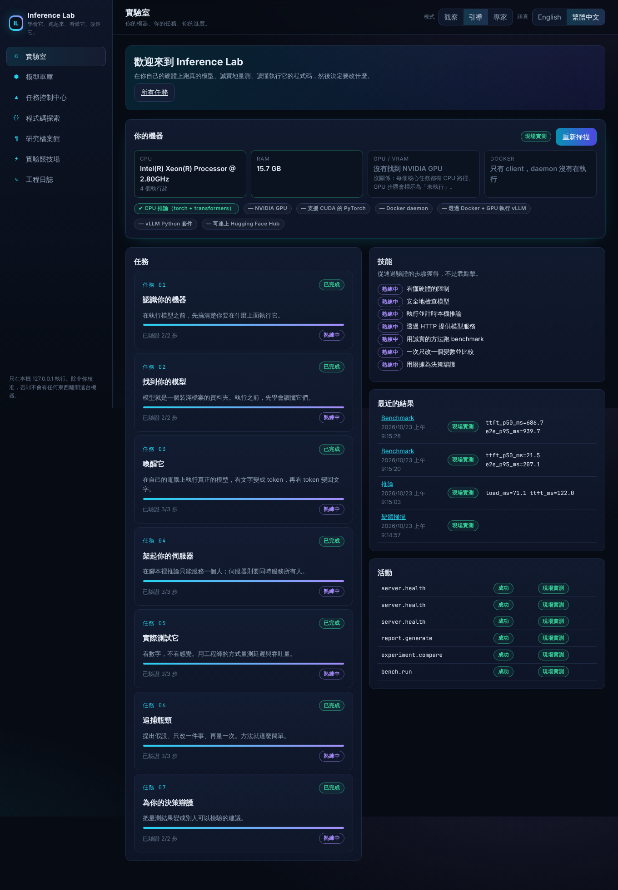

# Inference Lab

**學會它、跑起來、看懂它、改進它。**

[English](README.md)

Inference Lab 是一個在本機執行的互動式工作台，用來學習 AI 推論工程。你會在自己的電腦上跑真的模型、用誠實的方法做
benchmark、閱讀實際執行的程式碼、一次只改一個變數做比較，最後用證據為你的決策辯護。每個數字都會標示來源，沒有任何模擬結果。



## 示範影片

[](https://github.com/joojoohappy/Inference_Lab/blob/main/docs/media/inference-lab-demo-720p.mp4)

三分半的導覽影片，附中英雙語字幕：硬體掃描、七個任務全部實際執行、Experiment Arena、Model Garage、Code Explorer、
Research Archive 與 Engineering Journal，以及在 Snapdragon X Plus 筆電上的 llama.cpp 實測結果（CPU 33.0 tok/s，
Adreno GPU 17.8 tok/s；vLLM 因為沒有 GPU 標示為 NOT RUN）。介面操作畫面是在只有 CPU 的雲端環境錄製的，等待運算的時間有剪掉或加速。

## 快速開始（CPU，可離線）

需求：Python 3.10 以上（已在 3.13 測試）、Node 20 以上（已在 22 測試，用來建置 UI）。

```bash
git clone <this repo> inference-lab && cd inference-lab
python -m venv .venv && . .venv/bin/activate
pip install torch --index-url https://download.pytorch.org/whl/cpu    # 有 GPU 的話請改裝對應的 CUDA 版本
pip install -e ".[inference,dev]"
(cd frontend && npm ci && npm run build)
inference-lab ui            # → http://127.0.0.1:8765
```

介面預設為**英文**。請用右上角的語言切換按鈕切換成繁體中文；你的選擇會記在這台電腦上，切換語言不會影響你的進度。
程式碼、指令參數、模型 ID、設定鍵和路徑都保留原文，不會被翻譯。

## 裡面有什麼

| 區域 | 你可以做的事 |
|---|---|
| **實驗室** | 掃描你的機器，查看任務、技能和最近的結果 |
| **模型車庫** | 用 ID 或網址檢查 Hugging Face 模型（只讀中繼資料）、估算記憶體、檢查相容性；經你核准才會下載；試跑推論 |
| **任務控制中心** | 七個任務，從「認識你的機器」到「為你的決策辯護」 |
| **程式碼探索** | 閱讀每個步驟實際執行的原始碼，附行號範圍與四種解說深度 |
| **研究檔案館** | 一手來源（論文、官方文件）與查核紀錄；KV cache 與延遲/吞吐量互動圖解 |
| **實驗競技場** | 啟動伺服器、跑 benchmark、比較兩次執行、查看根據證據的建議 |
| **工程日誌** | 每一次實驗與執行（包含失敗的）、筆記、匯入/匯出、中英文報告 |

模式：**觀察**（看核准的流程自動執行）、**引導**（你自己執行每一步，有提示）、**專家**（直接給所有參數）。
三種模式使用同一套執行與驗證引擎。

## 資料來源標示

| 標示 | 意義 |
|---|---|
| `LIVE_MEASURED`（現場實測） | 在這台機器上由這個 repository 的程式碼量測 |
| `VERIFIED_IMPORTED`（已驗證匯入） | 從結構與 checksum 都驗證過的檔案匯入 |
| `DEMO_SAMPLE`（示範資料） | 教學用的合成資料，絕不當作證據 |
| `NOT_RUN`（未執行） | 沒有執行（通常是缺少 GPU 等能力） |
| `FAILED`（失敗） | 有執行但失敗；會保留並顯示 |

報告只會把「現場實測」和「已驗證匯入」的結果當作結論。

## 命令列

命令列和介面使用同一套動作：

```bash
inference-lab hardware
inference-lab prepare-tiny
inference-lab infer --prompt "The KV cache stores" --max-new-tokens 16
inference-lab bench --concurrency 1 --trials 3
inference-lab bench --concurrency 4 --trials 3
inference-lab experiments
inference-lab compare <baseline-id> <candidate-id>
inference-lab report <id> <id> --lang zh-TW
```

## GPU 路徑（選用）

如果有 NVIDIA GPU、NVIDIA Container Toolkit 和 Docker，任務 04 可以啟動 vLLM（`vllm/vllm-openai`，只綁定 127.0.0.1）。
請參考 `docker/vllm/docker-compose.yml`。建置環境沒有 GPU，所以這條路徑**沒有實際執行過**。沒有 GPU 時，
這些步驟會顯示為「未執行」，不會卡住你的進度。

## 透過 llmbench 使用 llama.cpp（CPU 或 Adreno GPU）

如果 llm-inference-bench 專案（llmbench）放在這個 repo 旁邊，Inference Lab 會直接使用它的 llama.cpp 執行檔
（`tools/llama-cpu`、`tools/llama-adreno`）和 GGUF 模型（`models/*.gguf`），不會複製或修改。放在別處時請設定
`INFERENCE_LAB_LLMBENCH_DIR`。模型名稱寫成 `gguf:<檔名>`。

```bash
inference-lab bench --kind llamacpp-adreno --model gguf:qwen3-4b-instruct-2507-Q4_0 --port 8870 --max-tokens 64
```

實驗競技場也有這兩個引擎。在 Snapdragon X 筆電上的實測結果請見 [docs/LOCAL_TEST_REPORT.md](docs/LOCAL_TEST_REPORT.md)。

## 選用的 AI 家教

不需要任何付費 API，家教也能運作（使用人工整理的解說和 docstring）。若要接上模型，請看英文 README 的
「Optional AI tutor」一節的環境變數設定。AI 永遠不會決定任務是否完成、不會拿到 shell，而且只會收到去除密鑰後的文字。

## 測試

```bash
pytest                                   # 後端：133 個通過，沒有 GPU 時 2 個 GPU 測試會標為 NOT RUN 並略過
cd frontend && npm test                  # 元件與 i18n 測試
npm run i18n:check                       # 檢查 en / zh-TW 的 key 是否一致
npx playwright test                      # 真實瀏覽器：語言、完整任務流程、核准機制、截圖
```

## 文件

設計文件在 `docs/`（英文）：架構稽核、架構、任務結構、執行與驗證、程式碼探索、實驗流程、已知限制、路線圖與實作報告。
